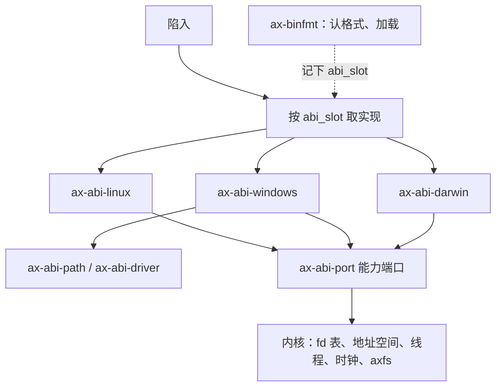

同一台 x86_64 机器，Linux、Windows、macOS 给程序的是同一批能力：读写文件、映射内存、建线程、计时。不同的是三件事：程序怎么进内核，可执行文件长什么样，路径、换行、设备名这些约定怎么写。StarryOS 把这一层拆成可替换的包，Windows 与 macOS 各一套，分别参考 Wine 与 Darling。

<!-- more -->

## 三家各自的稳定边界

| | Linux | Windows | macOS |
|:--:|:--:|:--:|:--:|
| 稳定的边界 | 系统调用号 | DLL 导出的函数名 | libSystem 导出的符号名 |
| 调用号 | 固定，永不改义 | 每个版本都可能变 | 不承诺稳定 |
| 程序直接 `syscall` | 可以，静态链接常见 | 少数程序这么做，换个版本就可能坏 | 不支持，苹果不支持静态链接 |
| 失败怎么报 | 返回负的 errno | NTSTATUS；Win32 层再换成 `GetLastError` | 返回 errno，同时置进位标志 |

Linux 的调用号就是 ABI：x86_64 上号放 `rax`，参数依次放 `rdi`、`rsi`、`rdx`、`r10`、`r8`、`r9`，libc 只是一层薄包装。另外两家的稳定边界在用户态的库里，下面分开讲。

## Windows

### 官方

分层是 应用 → Win32 API（`kernel32`、`kernelbase`、`user32`……）→ `ntdll.dll` → 内核 `ntoskrnl.exe`（图形相关在 `win32k.sys`）。`ntdll` 是用户态里离内核最近的一层：`Nt*` 系列的系统调用桩、PE 加载器（`Ldr*`）都在它里面。调用号由同版本的 `ntdll` 与内核约定，[每个版本都在变](https://j00ru.vexillium.org/syscalls/nt/64/)，所以程序认的是函数名。

一个进程起来时，`ntdll` 建好进程环境块（PEB）与线程环境块（TEB），`gs` 指向 TEB；然后按 exe 的导入表加载 DLL、填导入地址表，依次通知每个 DLL「进程已建立」，最后进 exe 的入口。

### 参考：Wine 与 ReactOS

[Wine](https://gitlab.winehq.org/wine/wine) 在 Linux 之上用用户态把这套重写了一遍：

- 一个 Windows 进程就是一个 Linux 进程，Windows 线程就是 Linux 线程。
- `ntdll` 分成两半：PE 格式的一半给 Windows 程序链接，需要碰宿主系统的另一半是普通的 Unix 库，两边经 `__wine_unix_call` 衔接。
- 句柄、同步对象、进程这些「内核对象」由一个单独的进程 wineserver 统一管理。
- 盘符 `Z:` 默认指向 Linux 的根 `/`。
- 少数程序（多为带防护的游戏）绕过 `ntdll` 直接发 `syscall`；Linux 5.11 为此加了 [Syscall User Dispatch](https://docs.kernel.org/admin-guide/syscall-user-dispatch.html)，Wine 从 11.5 起用它把这类调用转回自己处理。

[ReactOS](https://github.com/reactos/reactos) 则是重写 NT 内核本身，用来查 TEB、PEB 的结构与偏移，以及 NT 调用在内核侧的行为。

我们主要拿 Wine 查三样东西：函数语义（`dlls/kernel32`、`dlls/kernelbase`）、错误码怎么映射（`errno_to_status`）、导入绑定的顺序。

### abi-win

包名 `ax-abi-windows`，代码在 [`feat-personality-win`](https://github.com/Lfan-ke/tgoskits/tree/feat-personality-win)。与 Wine 最大的不同：Win32 这条边界不在用户态，而在随内核运行的包里。

- **系统库由内核合成**：加载器走导入表时，`KERNEL32`、`WS2_32`、`ADVAPI32` 等 14 个库的 421 个入口各绑到一段 48 字节的替身代码：把 Windows 调用约定的 `rcx`、`rdx`、`r8`、`r9` 与栈上参数挪进陷入约定的寄存器，以 `0x1000 + 下标` 陷入。合成库带导出目录，`GetModuleHandleW` 加 `GetProcAddress` 照样能答。
- **随程序发布的 DLL 照常加载**：`python314.dll`、`vcruntime140.dll`、`ucrtbase.dll`、`.pyd` 从程序目录与 `/windows/system32` 找到后按 PE 映射，做 `.reloc` 重定位与导入绑定。
- **没有 wineserver**：句柄直接对应内核的文件描述符，同步、管道、套接字都走内核已有的实现。
- **直接发 NT 调用的程序也认**：落在 NT 调用号上的陷入交给 NT 那一路分发。
- **进程起来前**建好 TEB 与 PEB，`gs` 指向 TEB；程序从一段 attach 跳板起跑，先通知各 DLL，再进入口；`ExitProcess` 先跑各 DLL 的退出通知（C 运行库在这里冲刷缓冲），再结束进程。
- **报错**：端口返回的 errno 照 Wine 的对照表换成 NTSTATUS。

验收程序是 python.org 的 Windows 版 CPython 3.14.7：`platform.platform()` 得 `Windows-10-10.0.19041-SP0`，经 `ctypes` 调 `kernel32.GetCurrentProcessId()` 也能拿到结果。

## macOS

### 官方

分层是 应用 → `libSystem.B.dylib`（`libsystem_c`、`libsystem_pthread`、放系统调用桩的 `libsystem_kernel`……）→ XNU。XNU 由 BSD 与 Mach 两部分组成，陷入按类别分：BSD 调用是类别 2（号加 `0x2000000`），Mach trap 是类别 1，另有机器相关与诊断两类。苹果不保证调用号稳定，也[不支持静态链接](https://developer.apple.com/library/archive/qa/qa1118/_index.html)；Go 从 [1.11](https://go.dev/doc/go1.11) 起在 macOS 上改为经 libSystem 调用，就是这个原因。

内核把可执行文件与 dyld 映射进来，dyld 负责其余的事：加载 `LC_LOAD_DYLIB` 列出的库，执行 rebase 与 bind，按加载顺序调各镜像的初始化函数，最后调 `LC_MAIN` 指定的 `main`，用它的返回值调 `exit`。

### 参考：XNU、dyld 与 Darling

- [XNU](https://github.com/apple-oss-distributions/xnu) 与 [dyld](https://github.com/apple-oss-distributions/dyld) 苹果都开源了：调用号与参数查 `bsd/kern/syscalls.master`，绑定格式与初始化顺序查 dyld。
- [Darling](https://github.com/darlinghq/darling) 是 macOS 程序在 Linux 上的兼容层，地位相当于 Wine：用一个很小的加载器启动苹果开源的 dyld；`libSystem` 尽量用苹果源码编；Mach 端口一类 XNU 才有的服务由用户态的 [darlingserver](https://docs.darlinghq.org/internals/darlingserver/index.html) 提供，它直接复用了一部分 XNU 源码，早年放在内核模块里的做法已经弃用。

### abi-mac

包名 `ax-abi-darwin`，代码在 [`feat-personality-mac`](https://github.com/Lfan-ke/tgoskits/tree/feat-personality-mac)。与 Darling 的不同：没有 dyld，也不跑苹果的 libSystem，两者的活都由内核里的包做。

- **libSystem 由内核合成**：382 个入口加 8 个变量，按 python.org 的 CPython 3.14 及其扩展模块实际绑定的符号列出。每个入口是一段很短的陷入代码：挪开 `rcx`（C 调用约定与陷入约定只差这一个寄存器），以 `0x0F000000 + 下标` 陷入；返回时若进位标志置位，就把 errno 写进线程私有区、返回 -1。`0x0F000000` 在 XNU 的四个类别之外，不会与程序自己发出的调用相撞。
- **dyld 的活由包做完**：rebase 与 bind 两条操作码流在程序起跑前全部执行，缺一个符号就拒绝加载；启动代码先调各镜像的 `__mod_init_func`，再调 `main`，返回值交给 `exit`。
- **扩展模块经 `dlopen` 在运行时加载**，已加载镜像的表放在进程自己的内存里。
- **通用二进制**：从切片表里挑 x86_64 那片加载。
- **进位标志由内核写**：返回用户态前按成败设置标志寄存器的进位位。

验收程序是 python.org 的 macOS 版 CPython 3.14.7：交互解释器可用，`platform.platform()` 得 `Darwin-20.6.0-x86_64-64bit`，`os.uname()` 得 `Darwin 20.6.0 x86_64`。

## abi-linux

StarryOS 原本就实现 Linux 的系统调用，拆包时把这张表连同 ELF 加载整体搬进 `ax-abi-linux`，行为不变。验收程序是 Alpine 的 CPython 3.14.7，测试套件 23 个模块全部通过。内核默认只链接这一套，另外两套由 `starry-kernel` 的 `abi-win`、`abi-mac` 打开。

## 加载器

### 从 SELF 说起

[SELF](https://github.com/fzakaria/selfdb) 把可执行文件存成 SQLite 数据库：段、符号都是表里的行。`file` 认出来是 `SQLite 3.x database, application id 0x53454c46`，`0x53454c46` 就是 ASCII 的 `SELF`，写在 SQLite 文件头偏移 68 处。Linux 的 `binfmt_misc` 按「偏移 0 是 SQLite 魔数、偏移 68 是 `SELF`」认出它，交给解释器 `self-exec`。`self-exec` 有三种跑法：重建出 ELF 再 `execveat`；自己映射段再交给 `ld.so`；自己当动态链接器，用 SQL 查符号做绑定（[作者的说明](https://fzakaria.com/2026/08/23/your-executable-is-a-sqlite-database)）。

由此可见：可执行格式只是一份描述，加载器照着描述把字节放到该放的地址上，任何能装下这份描述的容器都能当可执行文件。

### 自拟一个格式

假设我们定一个最简单的格式 TOY：

```c
struct toy_header {
    char     magic[4];     // "TOY\0"
    uint64_t entry;        // 入口的虚拟地址
    uint64_t stack_size;   // 要多大的栈
    uint32_t nseg, nimp;   // 段数、导入数
};
struct toy_segment {       // 一段代码或数据
    uint64_t file_off, file_size;
    uint64_t vaddr, mem_size;
    uint32_t prot;         // 读、写、执行
};
struct toy_import {        // 把 name 的地址写进 slot
    uint64_t slot;
    char     name[32];
};
```

加载它要五步：

1. **认格式**：读开头四个字节。
2. **映射**：每段在 `vaddr` 处映射 `mem_size` 字节，前 `file_size` 字节从文件 `file_off` 处来，其余填零（这就是 `.bss`），再按 `prot` 设权限。
3. **修地址**：按导入表把每个名字解析成地址，写进对应的槽。槽就是 ELF 的 GOT、PE 的 IAT。程序若没装在它想要的基址上，还要按重定位表把绝对地址挪一挪。
4. **建栈**：按 `stack_size` 分配，压入参数与环境变量。
5. **交出控制**：内核准备一份启动记录（入口、栈顶、线程指针），交给一小段跳板代码。跳板把栈指针换成记录里的值，设好线程指针，跳到入口。

三家真实的格式都是这五步，差别在字段怎么摆、动态链接交给谁。在 StarryOS 里，启动记录就是 `ax-binfmt` 的 `Loaded { entry, stack, thread_pointer }`，跳板就是上面说的 Windows 的 attach 跳板与 Darwin 的启动代码。

### ELF、PE、Mach-O

| | ELF | PE | Mach-O |
|:--:|:--:|:--:|:--:|
| 魔数 | `7f 45 4c 46`（`\x7fELF`） | 开头 `4d 5a`（`MZ`），偏移 `0x3c` 处的值指向 `PE\0\0` | `cf fa ed fe`（64 位）；通用二进制是 `ca fe ba be` |
| 描述段的结构 | 程序头 `PT_LOAD` | 节表（`.text`、`.rdata`、`.data`……） | 加载命令 `LC_SEGMENT_64` |
| 入口 | `e_entry` | `AddressOfEntryPoint`（相对基址） | `LC_MAIN` 的 `entryoff` |
| 换基址 | 位置无关的可执行文件加重定位表 | `ImageBase` 加 `.reloc` | rebase 操作码；新工具链改用链式修正 |
| 导入 | `DT_NEEDED` 加符号表，经 GOT、PLT | 导入表：DLL 名加函数名或序号，填 IAT | `LC_LOAD_DYLIB` 加 bind 操作码：库序号加符号名 |
| 谁做动态链接 | `PT_INTERP` 点名的 `ld.so` | `ntdll` 里的加载器 | `LC_LOAD_DYLINKER` 点名的 dyld |
| 内核交给进程的 | 栈上 `argc`、`argv`、`envp`、辅助向量 | 进程环境块由 `ntdll` 初始化 | 栈上 `argc`、`argv`、`envp`、`apple` |
| StarryOS 里 | 内核映射后照旧交给 `ld.so` | `ax-abi-windows` 自己绑定，系统库由内核合成 | `ax-abi-darwin` 执行 rebase、bind，libSystem 由内核合成 |

macOS 内核（XNU 的 [`bsd/kern/kern_exec.c`](https://github.com/apple-oss-distributions/xnu/blob/main/bsd/kern/kern_exec.c)）按文件头区分能直接执行的文件：

| 类型 | 文件开头的字节 | 常量 | 内核的处理 |
|:--:|:--:|:--:|:--:|
| 单架构 Mach-O，64 位 | `cf fa ed fe` | `MH_MAGIC_64`（0xfeedfacf，小端存放） | `filetype` 必须是 `MH_EXECUTE`，按加载命令映射 |
| 单架构 Mach-O，32 位 | `ce fa ed fe` | `MH_MAGIC`（0xfeedface，小端存放） | 格式能识别，macOS 10.15 起不再运行 32 位程序 |
| 通用二进制（fat） | `ca fe ba be` | `FAT_MAGIC`（0xcafebabe，大端存放） | 读切片表，选出与当前 CPU 匹配的切片，再按单架构 Mach-O 加载；切片里不能再嵌套通用二进制 |
| 脚本 | `23 21`（`#!`） | | 读第一行的解释器路径，改为加载解释器 |

字节序相反的 `MH_CIGAM`、`MH_CIGAM_64`（开头是 `fe ed fa ce`、`fe ed fa cf`）内核能认出，但直接返回 `EBADARCH`；切片偏移为 64 位的 `FAT_MAGIC_64`（`ca fe ba bf`）只在工具链里出现，exec 不接受。Java 的 class 文件开头也是 `ca fe ba be`，`file` 靠后面的字段区分。

python.org 发的 macOS 版 CPython 就是通用二进制，`cafebabe` 后面有两个切片：`0x1000007` 是 x86_64，`0x100000c` 是 arm64。StarryOS 的 Mach-O 加载器也先认 `cafebabe`，从切片表里选出 x86_64 那片（偏移 `0x4000`），再按切片开头的 `cffaedfe` 加载。

### `#!` 脚本与 binfmt_misc

- **`#!`**：内核读到文件开头是 `#!`，就把这一行写的解释器当程序加载，脚本路径作为参数（Linux 的 [`fs/binfmt_script.c`](https://github.com/torvalds/linux/blob/master/fs/binfmt_script.c)）。macOS 同样支持；Windows 内核不认，靠资源管理器与命令行按扩展名关联打开。
- **binfmt_misc**：Linux 让用户态按「偏移加魔数」或扩展名注册解释器，写 `/proc/sys/fs/binfmt_misc/register`，格式是 `:名字:类型:偏移:魔数:掩码:解释器:标志`。qemu-user 跑别的架构的程序、Wine 直接执行 `.exe`、上面的 SELF，都靠它。
- **StarryOS 里**：`ax-binfmt` 的 `register_binfmt!` 注册格式，`dispatch_image()` 按文件头挑格式，作用相当于 Linux 的 `search_binary_handler`；`LoadEnv::interpret` 对应「换一个解释器接着加载」，`#!` 与 `PT_INTERP` 都走它。

## 三套系统的约定差异

把系统调用拆成独立的包时，要逐项处理这些差别：

| 项 | Linux | Windows | macOS |
|:--:|:--:|:--:|:--:|
| 路径分隔符 | `/` | `\`（API 也接受 `/`） | `/` |
| 根 | 单一根 `/` | 盘符 `C:\`；`\\?\` 是长路径前缀 | 单一根 `/` |
| 大小写 | 区分 | NTFS 默认不区分 | APFS 默认不区分 |
| 换行 | LF | CRLF | LF（经典 Mac OS 是 CR） |
| 怎么算可执行 | 执行权限位加文件头 | 扩展名（`.exe`、`.dll`）加 PE 头 | 执行权限位加 Mach-O 头 |
| 保留文件名 | 无 | `CON`、`PRN`、`AUX`、`NUL`、`COM1` 至 `COM9`、`LPT1` 至 `LPT9` | 无 |
| 串口 | `/dev/ttyS0`；USB 转串口 `/dev/ttyUSB0`、`/dev/ttyACM0` | `COM1`；`COM10` 起要写 `\\.\COM10` | `/dev/tty.usbserial-*`（接入）、`/dev/cu.usbserial-*`（拨出） |
| 磁盘 | `/dev/sda`、`/dev/nvme0n1` | `\\.\PhysicalDrive0` | `/dev/disk0`、裸设备 `/dev/rdisk0` |
| 环境变量里的路径分隔 | `:` | `;` | `:` |
| 动态库 | `.so` | `.dll` | `.dylib`、`.framework` |
| 函数调用约定 | `rdi`、`rsi`、`rdx`、`rcx`、`r8`、`r9` | `rcx`、`rdx`、`r8`、`r9`，另留 32 字节影子空间 | 同 Linux |
| 线程指针 | `fs` | `gs` 指向 TEB | `gs` 指向线程私有区 |
| 时间起点 | 1970 年，秒与纳秒 | 1601 年，100 纳秒为单位 | 1970 年 |

在 StarryOS 上的处理：

- 路径：`ax-abi-path` 换分隔符、去掉 `\\?\` 与 `\??\` 前缀、转换盘符、按 Windows 的规则不区分大小写比较。演示里 Windows 版 Python 的 `sys.executable` 是 `Z:\python\python.exe`，对应的文件是 `/python/python.exe`。
- 设备：Windows 程序经 `NtDeviceIoControlFile` 访问设备，`ax-abi-driver` 把打包的控制码（`CTL_CODE`）解码，再交给内核的驱动。
- 调用约定、线程指针：在替身代码与进程初始化里处理，见前文。
- 报错：Linux 原样返回 errno，Windows 换成 NTSTATUS，Darwin 返回 errno 并置进位标志。
- 换行、环境变量分隔这些归运行库管，内核不碰。

## 人格包的分层



| 包 | 做什么 |
|:--:|:--:|
| `ax-dispatch` | 登记编进内核的各套实现，按进程所属的 ABI 分发陷入 |
| `ax-binfmt` | 按文件头认格式，交给认领它的包加载 |
| `ax-abi-port` | 能力端口：文件、路径、内存、任务、信号、时钟、随机数、套接字 |
| `ax-abi` | 按 feature 选哪几套进链接，给出默认分发策略 |
| `ax-abi-linux`、`ax-abi-windows`、`ax-abi-darwin` | 三套参考实现 |
| `ax-abi-path`、`ax-abi-driver` | Windows 的路径与设备控制码转换 |
| `ax-abi-embedded`、`ax-abi-custom` | 中断向量表；用户扩展的调用号段 |

这样分的理由：

1. **差别只在系统调用这一层**：读写文件、映射内存这些能力三家相同，内核只实现一遍能力端口，各家包只管把自己的参数解码、把结果编码。
2. **编进内核就自动登记**：每个包用 `linkme` 的分布式切片登记自己，没有中心名单；去掉一个包，内核不用改。
3. **调用号会撞**：NT 的 `WriteFile` 与 Linux 的 `write` 在 x86_64 上都是 1。所以进程控制块记下 `abi_slot`，加载镜像时写入，fork 时照抄，陷入时按它直接取实现，不搜索。
4. **返回值由实现自己写回**：负 errno、NTSTATUS、errno 加进位标志，各写各的。
5. **系统库移进内核**：Windows 与 macOS 的稳定边界本来就在用户态的库里、靠名字找到，这里在进程里合成这些库，每个入口是一段很短的陷入代码。

判断标准：加第四种 ABI，或给现有 ABI 加入口，都只加数据（新的包、表里的新项），不改结构。

## 扩展方向

### Windows：参考 Wine

1. 找没实现的入口：程序调到这类入口时，内核日志有一行 `abi: X is not implemented`。
2. 在 Wine 里找同名函数（`dlls/kernel32`、`dlls/kernelbase`、`dlls/ntdll`），看它最终落到哪个 NT 调用、错误怎么映射。
3. 在 `ax-abi-windows` 的表里加一项（库名加函数名），实现里只做参数解码与结果编码，干活交给端口。
4. 端口缺能力，就在 `ax-abi-port` 加一个方法，内核实现一次，三套 ABI 都能用。
5. 用 python.org 的 Windows 版 CPython 跑同一套测试当验收。

### macOS：参考 XNU、dyld 与 Darling

1. 调用号与参数查 XNU 的 `syscalls.master`，返回值与 errno 查对应的 `bsd/kern` 源码。
2. libSystem 层的函数加进 `ax-abi-darwin` 的符号表；BSD 调用加进按调用号分发的那张表。
3. 进程与事件（`fork`、`pipe`、`kqueue`、线程、信号）在 Linux 端口里都有对应能力，要补的主要是编解码与 Mach 端口的语义，darlingserver 怎么在 Linux 上实现这些可以直接参考。
4. 新工具链默认的链式修正（`LC_DYLD_CHAINED_FIXUPS`）是加载器要补的另一种绑定格式，照 dyld 源码实现。

## 相关链接

- 设计文档：[`docs/design/syscall-abi-packages.md`](https://github.com/Lfan-ke/tgoskits/blob/feat-personality-win/docs/design/syscall-abi-packages.md)
- 代码：[`feat-personality-win`](https://github.com/Lfan-ke/tgoskits/tree/feat-personality-win)（Linux 与 Windows）、[`feat-personality-mac`](https://github.com/Lfan-ke/tgoskits/tree/feat-personality-mac)（Darwin）
- 设计讨论：[rcore-os/tgoskits#2202](https://github.com/rcore-os/tgoskits/issues/2202)
- 周报与总结：[wiki](https://github.com/Lfan-ke/tgoskits/wiki)
