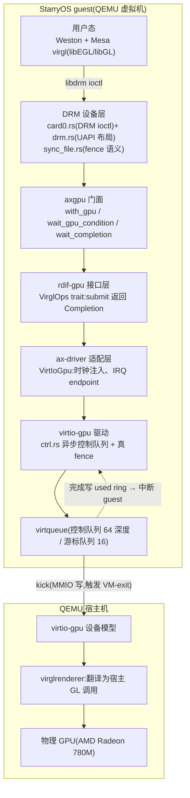
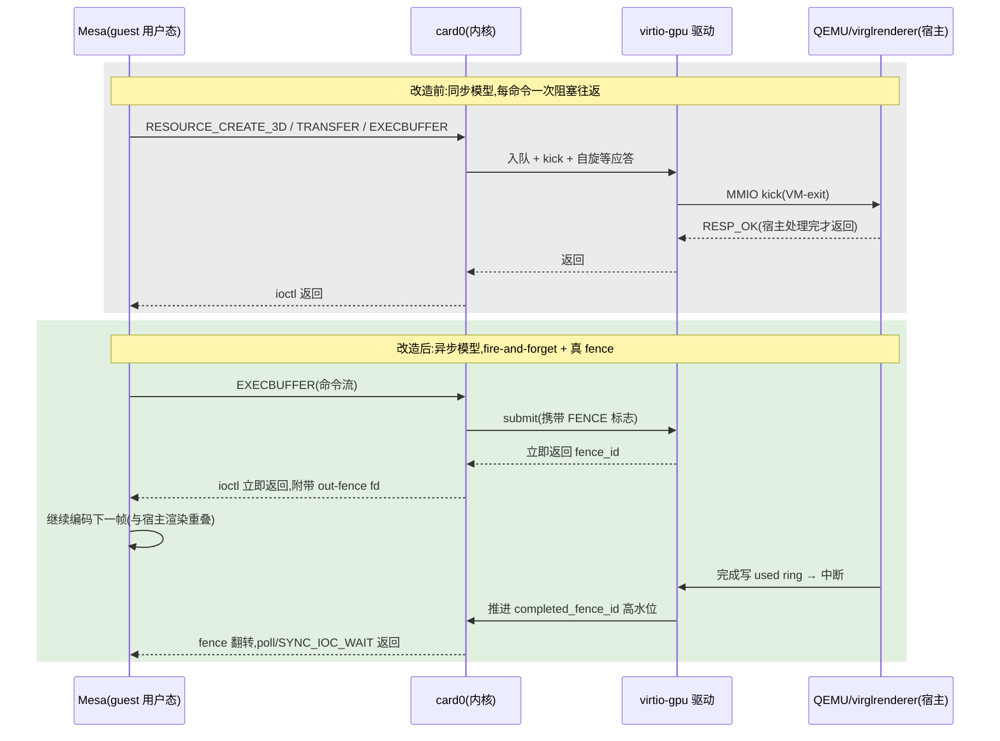
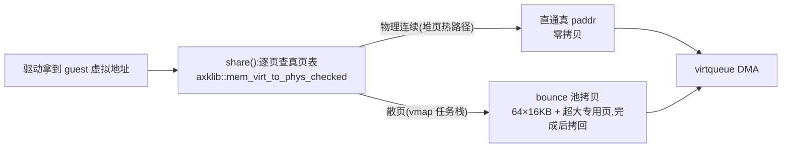
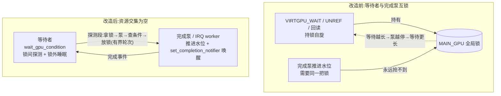
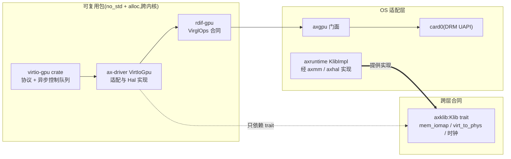
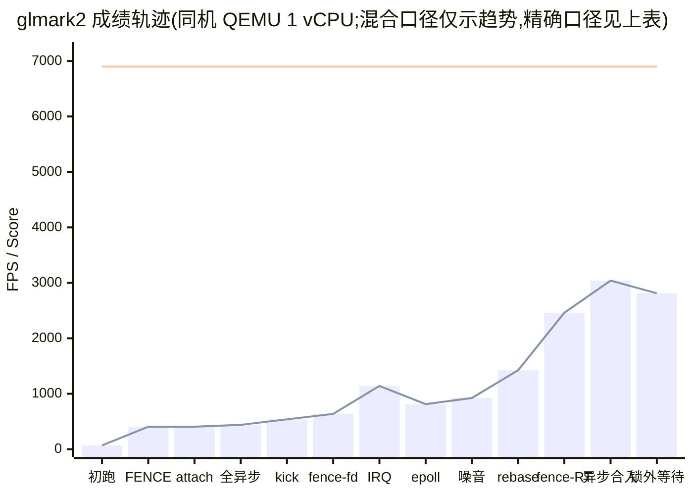

## 1. 摘要

2026 年 7 月到 10 月,我在 rcore-os/TGOSKits 社区实习,任务是给 StarryOS 实现 virgl 虚拟化 GPU(virtio-gpu 3D)加速,并让它的图形性能尽可能接近同机 Linux 虚拟机。实习结束时:

- **功能**:StarryOS 上 Weston + glmark2-es2-wayland 完整跑通 33 个场景,`GL_RENDERER=virgl`,宿主机真实 GPU(AMD Radeon 780M)完成渲染,用户态 Mesa 零改动;
- **性能**:glmark2 总分从第一次跑通的 69 分提升到 3000 分上下,约为同机 Linux 虚拟机(6100~7000 分)的一半;渲染循环帧时间从 2.17 ms 压到 0.33 ms;
- **正确性**:guest 侧三类会整机冻结的结构性缺陷被根除,重场景 10 轮浸泡测试 50/50 退出码全 0、零冻结;
- **产出**:向 rcore-os/virtio-drivers 与 rcore-os/tgoskits 提交 7 个拉取请求,6 个已合入主线,1 个开放(virtio-drivers 的异步控制队列 #265)。

本报告按三个阶段组织:功能打通(第 4 章)、性能优化战役(第 5 章)、工程化落地(第 6 章)。第 3 章先给出整体架构与"一帧的生命周期",作为后文所有讨论的地图;第 7 章单独讨论贯穿三个阶段的组件化设计;第 8 章汇总成果与数据,第 9 章如实声明边界与后续工作。

## 2. 项目目标与起点

### 2.1 任务定义

StarryOS 是 TGOSKits 仓库中面向 Linux 用户态二进制接口的研究用宏内核,此前图形栈只有 2D dumb buffer 路径,应用没有 OpenGL 可用。任务目标:在组件化内核中实现 virgl 驱动——通过 PCI 枚举发现设备并初始化 virtqueue,实现 DRM 设备节点及约 10 个核心 ioctl,把 Mesa virgl 用户态封装的 Gallium 命令流经 virtqueue 转发到 QEMU 宿主机,由宿主机 GPU 完成渲染。验收口径从第一天起就是可量化的:Weston + glmark2 能否完整出分,以及分数与同机 Linux 虚拟机的比值。

### 2.2 基线:先造标尺

动手写代码之前,先做了同法对照实验:同一台宿主机、同一套 QEMU 参数,先跑 Alpine Linux 虚拟机(装 Weston + glmark2)作为参照系;再保持其他变量完全一致,只把内核换成 StarryOS。结果如下。

| 环境 | 内核 | CPU 渲染(llvmpipe) | GPU 渲染(virgl) |
| --- | --- | --- | --- |
| QEMU + KVM,4 vCPU | Alpine Linux | 约 700~800 FPS | 约 9000 FPS(宿主核显直通) |
| 同上,仅换内核 | StarryOS | 约 500 FPS | **不支持** |



这组数字在动手前就确立了两件事:硬件加速对图形场景的收益是数量级的;而两侧用户态完全相同,差距全部来自内核侧。此后三个月,所有性能结论都遵守同一条纪律——同机、同用户态、唯一变量,背靠背 A/B。

## 3. 总体架构

### 3.1 软件栈分层

最终落地的图形栈自上而下分为 guest 侧五层与宿主机侧三段,每层只依赖下一层的接口。理解这张分层图是理解后文所有修改的前提:同一个问题可能出在任意一层,而修复必须落在语义上属于它的那一层。



各层的职责与关键代码锚点如下。`card0.rs`(约 4300 行,内核 DRM 层)实现 Linux 同款 `VIRTGPU_*` ioctl 与每上下文资源管理;`sync_file.rs` 实现 Linux `sync_file` 语义(`SYNC_IOC_WAIT`、poll、真 fence 翻转);`axgpu` 是 OS 侧 GPU 门面,对外提供 `with_gpu` 系列闭包、`wait_gpu_condition`/`wait_completion` 锁外等待原语与 `set_completion_notifier` 完成通知注册;`rdif-gpu` 以 `VirglOps` trait 定义驱动合同,`submit` 返回 `Completion` 完成令牌;`drivers/gpu/virtio-gpu/src/ctrl.rs` 是异步控制队列本体;`ax-driver` 负责把驱动接入平台(时钟注入、中断注册、`Hal` 地址翻译)。设备可见地址的最终设计很克制:异步热路径的命令字节全部拷进驱动自有、地址稳定的 DMA arena,翻译由 `ax-driver` 实现的 `Hal::share` 承担;仅存的零拷贝同步路径 `request_sync` 以文档契约要求调用方传入地址可忠实翻译的内存——这段设计的由来见 5.9 节,合同本身见 7.2 节。

### 3.2 一帧的生命周期

性能优化的对象是"一帧的时间都花在哪"。把渲染循环拆开,一帧的构成如下。

| 阶段 | 发生什么 | 耗时属性 |
| --- | --- | --- |
| ① 应用渲染 | glmark2 经 EGL 画一帧,提交给 Weston | guest CPU |
| ② Mesa 编码 | Gallium virgl 驱动把 GL 状态变化编码为 virgl 命令流(每帧几十~几百条 GPU 命令) | guest CPU |
| ③ EXECBUFFER ioctl | Mesa 携命令流指针 + BO 句柄进内核;内核分配 fence_id,调 `submit`,末尾统一 kick | guest CPU + 1 次 MMIO |
| ④ 队列传输 | 驱动把 CtrlHeader + 命令流挂上 virtqueue(indirect 描述符) | µs 级 |
| ⑤ 宿主处理 | QEMU 取命令 → virglrenderer 翻译成宿主 GL → 真实 GPU 渲染 | 宿主 CPU/GPU,帧的主要耗时 |
| ⑥ fence 完成 | 渲染完成后设备写 used ring → 注入中断 | 中断延迟 |
| ⑦ guest 收割 | IRQ 推进 `completed_fence_id`;Mesa 的 WAIT/poll 看到完成 | guest CPU,µs 级 |
| ⑧ present | Weston atomic commit → set_scanout / resource_flush | guest CPU + 队列传输 |

这张表有两个用途:它定义了"帧时间"的测量边界(从 ① 到 ⑧ 的墙钟),也预告了优化的两个方向——减少每个环节的固定开销(第 5 章),以及让 ③④ 与 ⑤ 重叠起来(异步化)。

### 3.3 同步模型与异步模型

实习开始时上游 virtio-drivers 的提交模型是全同步的:每条命令入队 → kick → 自旋等宿主应答 → 弹出,一条命令一次完整往返。改造目标是对齐 Linux `drivers/gpu/drm/virtio/` 的模型:热路径命令 fire-and-forget 入队即返回,唯一保留的等待是 fence,因为它表达真实的 GPU 依赖。两种模型的时序对比如下。



两种模型的帧时间公式完全不同。同步模型下所有环节完全串行,一帧 3~5 个阻塞往返,其中 `SUBMIT_3D` 阻塞到渲染完成,guest 在宿主渲染期间完全空转:

> T帧 ≈ [创建+RTT] + [挂载+RTT] + [上传+RTT] + [提交+RTT(含整个渲染等待)] + [present+RTT×2]

异步模型下 guest 编码第 N+1 帧与宿主渲染第 N 帧重叠:

> T帧 ≈ max(guest 每帧编码, 宿主每帧渲染) + 一次批量 kick 延迟 + fence 唤醒延迟

这个对比是整个性能战役的纲。但 5.2 节会看到:只异步化"看得见"的两个同步点,实测反而变慢——真正的工作是把每帧隐藏的同步点全部数出来。

## 4. 功能打通(第 1~5 周)

### 4.1 协议调研

实现的参照物有三份:Linux 内核 `drivers/gpu/drm/virtio/`(最权威的驱动实现)、`include/uapi/linux/virtio_gpu.h`(全部命令定义)、Mesa 的 `src/gallium/include/state_tracker/virgl.xml`(命令流编码协议)。virtio-gpu 层面的关键事实:所有命令共享 24 字节的 `virtio_gpu_ctrl_hdr`(type、flags、fence_id、ctx_id、ring_idx),3D 能力由一组命令承载——`CTX_CREATE`、`RESOURCE_CREATE_3D`、`TRANSFER_TO/FROM_HOST_3D`、`SUBMIT_3D` 等;能力协商走 capset 机制,OpenGL 加速对应 `VIRGL2`(capset id=2)。

Mesa 侧的 virgl 命令流是另一层编码:每条命令的首个 dword 由 `VIRGL_CMD0(cmd, obj, len)` 打包(命令 ID、对象类型、命令长度),其后按命令携带状态对象——`CREATE_OBJECT`(BLEND/RASTERIZER/SHADER 等十一类)、`SET_FRAMEBUFFER_STATE`、`CLEAR`、`DRAW_VBO` 等。调研结论整理成驱动层需要实现的命令清单与字节级布局表,这成为第二周编码的直接输入。

### 4.2 驱动层:virtio-drivers 的 3D 扩展

fork rcore-os/virtio-drivers 后,在 `device/gpu/mod.rs` 中新增了完整的 3D 命令面:数据结构(`CmdCtxCreate`、`CmdResourceCreate3d`、`CmdTransferToHost3d`、`CmdSubmit3d`、`GpuBox` 等)、常量(`VIRGL_CAPSET`、3D opcode)、方法(`ctx_create/destroy`、`ctx_attach/detach_resource`、`resource_create_3d`、`transfer_to/from_host_3d`、`submit_3d`、`get_capset(_info)`)。所有 3D 方法入口统一 `require_virgl()` 守卫:未协商 VIRGL feature 时返回错误而不是发出未定义命令。

测试先行写了 5 个单测,其中 `command_opcodes_match_upstream_header` 把所有 opcode 与 Linux `virtio_gpu.h` 逐一对表,`submit_3d_reports_error` / `resource_create_3d_reports_error` 对命令缓冲逐字节验证字段偏移。这批改动后来整理为 virtio-drivers #257(2026-08-14 合入)与 #258(2026-08-17 合入)。

### 4.3 从驱动到内核:三层封装与 DRM 设备层

驱动只是最底层。向上按仓库既有分层逐层封装:`drivers/interface/rdif-display` 定义纯 trait 接口(硬件无关的"合同",含错误码 `Gpu3dError` 与 `TransferBox`/`CapsetInfo` 结构);`drivers/ax-driver/src/virtio/display.rs` 的 `VirtIoDisplay<T>` 是唯一生产实现,获取 virtio 驱动设备所有权后把调用逐个委托下去;`os/arceos/modules/axdisplay` 在全局设备上暴露 `gpu3d_*` 系列门面函数,作为内核 DRM 层的命令入口。

内核侧是重头:在 `os/StarryOS/kernel/src/pseudofs/dev/drm.rs` 定义 11 个 `DRM_IOCTL_VIRTGPU_*` 的编号、flag 与用户态结构体,再在 `card0.rs` 按 Linux 同名 handler 一一对应实现。

| ioctl | 编号 | 职责(对应 Linux 实现) |
| --- | --- | --- |
| `VIRTGPU_MAP` | 0x41 | blob 资源 mmap 进用户空间 |
| `VIRTGPU_EXECBUFFER` | 0x42 | 提交 virgl 命令流(核心路径) |
| `VIRTGPU_GETPARAM` | 0x43 | 能力查询(fence-fd 等参数) |
| `VIRTGPU_RESOURCE_CREATE` | 0x44 | 创建 3D 资源 |
| `VIRTGPU_RESOURCE_INFO` | 0x45 | 查询资源信息(blob 类型等) |
| `VIRTGPU_TRANSFER_FROM_HOST` | 0x46 | 宿主→guest 数据回读 |
| `VIRTGPU_TRANSFER_TO_HOST` | 0x47 | guest→宿主数据上传 |
| `VIRTGPU_WAIT` | 0x48 | 等待 fence(渲染完成) |
| `VIRTGPU_GET_CAPS` | 0x49 | 获取 capset 二进制(能力集) |
| `VIRTGPU_RESOURCE_CREATE_BLOB` | 0x4a | 创建 blob 资源(共享内存) |
| `VIRTGPU_CONTEXT_INIT` | 0x4b | 渲染上下文初始化(capset_id/num_rings) |

每个 handler 只做三件事:按 UAPI 布局读用户参数、调用 `gpu3d_*` 门面把命令送到 virtqueue、按 Linux 语义回写结构与 errno。这层"与 Linux 一一对应"的纪律后来被证明极其重要——5.4 节的 fence 问题、6.4 节的释放语义问题,都是靠"对照 Linux 该是什么语义"来定位的。

### 4.4 让 Mesa 认出这块"显卡"

第一轮联调,glmark2 直接回退到 llvmpipe(CPU 软渲染)。把 glmark2/Mesa 的认卡逻辑逐条排查后找到四处协议失配:sysfs 中驱动名必须是 `virtio_gpu`(原实现叫 `starry-drm-simple`,用户态不认识);`/dev/dri/` 下必须同时有 `card0` 和 `renderD128`(原来只有前者);DRM ioctl 号由结构体大小参与编码,`DrmVirtgpuExecbuffer` 缺 syncobj 尾字段导致 64 字节布局落空,`DrmVirtgpuResourceCreateBlob` 则必须精确 48 字节;最隐蔽的是 `GETPARAM`——它的 `value` 字段是指针,原实现把值写进指针字段本身,能力协商因此读到全 0。逐一修正后,`GL_RENDERER` 终于变成 `virgl (AMD Radeon 780M Graphics ...)`。

### 4.5 黑屏:把宿主纹理送上扫描口

认卡之后渲染已在宿主真实发生,但 spice 窗口黑屏——这恰好证明像素确实在宿主 GPU 上,只是回不到显示通路。根因:Weston 的 scanout buffer 是 `RESOURCE_CREATE_3D` 建的宿主 3D 资源,而原 present 路径只会把 guest RAM memcpy 到扫描口,宿主纹理里的像素根本拷不出来。修复是把 `Framebuffer` 的 backing 分成两类:`FbBacking::Dumb`(保留原 memcpy 路径)与 `FbBacking::Gpu3d`(记资源句柄,present 时走 `set_scanout` + `resource_flush`,由宿主零拷贝直接把纹理送上显示)。`handle_addfb2` 相应地先查 dumb 表、再查 3D 资源表,让宿主资源也能注册成 framebuffer。



spice 窗口里 weston 桌面与 glmark2 旋转立方体正常显示,串口横幅如下。

```
=======================================================
    glmark2 2023.01
=======================================================
    OpenGL Information
    GL_VENDOR:      Mesa
    GL_RENDERER:    virgl (AMD Radeon 780M Graphics (radeonsi, phoenix, ACO, DR...)
    GL_VERSION:     OpenGL ES 3.2 Mesa 25.2.7
=======================================================
```

至此功能里程碑达成:3D 硬件加速通路完整,glmark2 可以完整出分。这一步比计划表的预计提前了两周,余下的时间全部投入性能。

## 5. 性能优化战役(第 7~11 周)

### 5.1 方法论:帧时间为北极星

性能工作遵守固定的循环:提出猜想 → 设计能证伪它的实验 → 修改 → 同机 A/B 实测 → 用数据决定保留或回滚。归因不靠猜,靠一套逐步建起来的测量资产:QEMU tracepoint 数每帧命令构成;LD_PRELOAD 拦截 guest 侧 ioctl 前后共写了六版;QMP 的 `x-query-virtio-queue-status` 取证队列状态;HMP `xp` 直读宿主视角物理内存;自研"瀑布插桩"把一个渲染循环逐段拆开计时。还有一条昂贵换来的纪律:串口日志每行约等于 100 FPS 级开销,任何测量必须先关日志。

### 5.2 异步化的第一次失败

按 3.3 节的纲,第一刀砍向最显眼的同步点:EXECBUFFER 和 present 的阻塞等待。实测结果反直觉——只异步化 EXECBUFFER 得 362 分,再加 present 得 357 分,都**低于**同步基线的 405 分(FENCE 位关闭的对照基线)。这个失败是关键线索:异步机器本身没问题,是没打中。把每帧的同步点全部数了一遍,发现还有 47 个同步 RTT 藏在别处——29 个资源挂载 + 18 个资源创建/销毁/上传,EXECBUFFER 自己的等待本来就只有几十微秒。

用 QEMU tracepoint 统计命令构成,答案直接写在计数里。

| tracepoint(≈ 命令) | 总数(一个 run) | 每帧 | Linux 同项 |
| --- | --- | --- | --- |
| `ctx_res_attach`(资源挂载到上下文) | 828,394 | **36.5** | **0** |
| `ctx_submit`(3D 提交) | 136,942 | 6.03 | ≈1 |
| `res_create_3d` / `res_back_attach` / `res_unref` | 各 ≈134,000 | 各 ≈5.9 | 启动期一次 |

每帧 36.5 次 attach 的根因在我自己的 DRM 层:EXECBUFFER 处理器对每个 BO 句柄每次提交都重新挂载一遍。讽刺的是代码里本来有个 `attached: bool` 字段想记录这件事,但它是个死字段——5 处写、0 处读。对照 Linux `virtgpu_gem.c`,正确语义是每个(资源, 打开它的上下文)只挂载一次;Weston 和 glmark2 是两个上下文共享同一批 buffer,所以按 `(ctx, resource)` 粒度用 `attached_ctxs: BTreeSet<u32>` 记录。修复后 373→406 分,重场景收益是轻场景的十倍——原因也清楚:重帧队列排得深,每个同步 RTT 都要等宿主排空积压,成本被放大。随后把剩下 18 个同步 RTT(创建/backing/销毁/上传)也全部 fire-and-forget,439 分。到这一步,每帧同步往返清零,收益与移除的 RTT 数严格线性。

| 轮次 | 改动 | Score | 验证对象 |
| --- | --- | --- | --- |
| exp0 | 同步 + FENCE 位开(等宿主渲染完才返回) | 367 | 基线 A |
| exp4 | 同步 + FENCE 位关 | **405** | 基线 B:分离"渲染等待" |
| exp5 | 仅 EXECBUFFER 异步 | 362 | EXECBUFFER RTT 的贡献 |
| exp6 | EXECBUFFER + present 异步 | 357 | present 2 RTT/帧的贡献 |
| exp7 | exp6 + smp4 | 373 | "单核并行限制"假设 |
| attachfix | attach 每 (ctx,res) 一次 | **406** | attach 风暴 |
| full-async | 全部生命周期命令 fire-and-forget | **439** | 剩余 18 个同步 RTT |

### 5.3 kick 合并:把 MMIO 税摊到整个事务

同步往返清零后,下一个靶子是 kick 本身——每次 kick 是一次 MMIO 写,在虚拟化里是一次 VM-exit。第一版按固定条数合并:命令入队后攒够 4 条才发一次 kick,立竿见影,ioctl 单价从 227~353µs 降到 35.6µs,内核里 present 切片从每帧 1.8~2.0ms 掉到 0.26ms。第二版想改成更精细的"每条命令入队时自己判断要不要 kick",结果反而回退:kick/帧从 1.42 涨到 5.16。重新对照 Linux `virtgpu_vq.c` 才发现关键:Linux 在 enqueue 时**从来不 notify**,只做一次计数,真正的 kick 统一放在 ioctl 收尾——合并的单位不是"命令条数",而是"一次系统调用"。落地为边界 notify 后,kick/帧收敛到 3.23(Linux 为 1.01,剩差来自每帧命令量),FPS 539。

这里顺手证伪了一个猜想:我原本以为 Linux 靠 `avail_event` 机制把 kick 压到每批一次,宿主侧 trace 实测 Linux 的 kick:command = 0.33,约等于每条 submit 一次 kick,没有什么"抑制魔法"。

### 5.4 真 fence:每帧一个 8×1 像素的线索

kick 合并后,host 侧对比发现 Starry 每帧多发一个 8×1 像素 R8 小资源的创建+挂载+销毁(一个 run 里 13 万次,而 Linux 全程只有 217 个、都在启动期)。这个资源不是纹理也不是顶点 buffer,LD_PRELOAD 拦截 ioctl(前后六版,踩过 ioctl 号抄错、dlsym 无限递归打穿栈的坑)也只看到行为看不到动机,最后靠反汇编定位到 Mesa 源码:它是 `virgl_drm_fence_create_legacy` 里 fence 的载体资源——Mesa 认为我的驱动不支持 fence-fd,退化到 legacy fence 模式,每提交一次就造一个资源当 fence 用完就扔。根因在版本协商:DRM version 的 minor 被固定成 0,Mesa 看到 minor<1 就置 `supports_fences=false`。

修复分三件事:`DRIVER_VERSION_MINOR` 0→1;EXECBUFFER 实现完整的 `FENCE_FD_IN`(导入 in-fence 并在提交前真实等待)与 `FENCE_FD_OUT`(创建未决 sync_file 绑定 fence_id,宿主完成才翻转);新建 `sync_file.rs` 实现 Linux sync_file 语义——关键是真的语义:初始未决、宿主完成才置位,如果返回"永远已完成"的假 fence,Mesa 的回读会读到脏数据。实测 texture 625/639/637,Mesa 侧 legacy fence 资源创建归零。

### 5.5 完成通知链:中断为什么没进来

真 fence 落地后,完成的传递靠一个 1ms 轮询的 refresher 任务兜底。控制变量实验证明轮询就是天花板:轮询 10ms 时 offscreen 掉到 97 FPS,改成提交后自旋 500µs 冲到 1277 FPS 但 on-screen 反而变差——轮询和自旋都是错误的兜底姿势,完成通知必须走中断。而中断进不来有三层原因,逐层揭开:其一,probe 时用了 masked transport,把 INTx 屏蔽了,QEMU 发了 32064 次 notify,PCI 层 0 次;其二,解开 mask 后系统死锁,3D 入口持普通 SpinLock,被完成中断打断后中断处理程序要拿同一把锁,单核下死锁,改 `lock_irqsave`;其三,中断里每次全量 pump + 扫描所有 fence 等待者开销太大,改成 handler 里 pump 一次 + 只查电平 + 只扫真正有 poller 的 fence。期间顺手修了一个:flip 事件的 poll 集合堆积了 13~17 个历史残留 waker,每次唤醒全部拉起(实测 850µs),改成单读者 `wake_one` 后 8µs。实测 offscreen 703→1141(+62%),atomic ioctl 均价 565µs→90µs。

### 5.6 epoll 自唤醒循环

到这一步 GPU 侧开销已压了不少,帧时间却还剩 2ms 量级。两组对照先排除嫌疑:glmark2 直连 DRM(不经 Weston)能跑 1059 FPS,说明合成链占约一半;把 Linux 虚拟机整个调度器换成和 Starry 一样的 SCHED_RR 反而跑到 6966 FPS,证明调度算法无罪。然后用零日志原子桶插桩把每次 `epoll_wait` 从入口到真正 park 的时间钉死:每次都要先排空约 13 条陈旧就绪条目,96.5% 是空的,每条约 10µs。根因在我的 poll 实现:PollSet 满 64 之后环形替换并唤醒被挤掉的旧条目,而 epoll 每次 wait 都新建一个全新 waker 且从不注销——新 waker 和旧 waker 永远认不出彼此(`will_wake` 不命中),"唤醒上一个自己"→条目重新入队→下次再排空,无限自循环。试了三版:A 去掉二次 poll,无效;B 等待期间抑制自触发唤醒,epoll 开销消失但把真实唤醒也抑制了,直接死锁;C 每个 interest 惰性缓存同一个 waker 复用注册,环形替换命中 `will_wake` 快路径,不再自唤醒。配套补了 `unregister` 家族(ppoll 返回、card0、sync_file、axtask poll_io 都按 waker 身份注销),防止残留 waker 吞掉 `wake_one` 饿死真等待者。实测 texture 500-520 → 778-813(+56%)。

### 5.7 后台噪音治理

最后一类是纯后台唤醒噪音,而且都是我自己代码造出来的:fence refresher 每 1ms 醒一次(实测约 1000 次/秒);串口维护线程空闲时固定 1ms 轮询;网卡收包线程 10ms 轮询且每次醒来把 net-poll 带醒,两个线程乒乓。修复:refresher 加全局 poller 计数门控,有人等才 1ms 服务,没人等 50ms 兜底停车(约 20 次/秒);串口按最后真实工作空闲退避,1ms→20ms,有输入立即恢复;网卡空闲退避到 1s。有个值得记录的现象:只修 refresher,机制计数好看了 50 倍但 FPS 纹丝不动;三个一起修才 +8.8%(888/924)。解释是 serial/net 的唤醒与 glmark2 的 ioctl 活动时间相关,更容易恰好落在 commit→Weston 的关键窗口里插队。这一阶段还有个插曲:GAP 插桩显示三个后台任务各以每秒 900 次插队,顺着查了半天全错——插桩的名字槽"第一次见到就固定",而这些 tid 早期属于别的任务,退出后被用户进程复用;给名字槽加任务指针校验后,真相是剩下每帧醒一次的都是 Wayland 管线自己的成员,Linux 带着同样的成员跑 6966 FPS,它们不是根因。

### 5.8 差距账本:剩下的是什么

插队问题关闭后差距还剩约 7.5 倍。瀑布插桩带来一个重要修正:系统里其实有两条循环——glmark2 渲染循环约 900 次/秒,Weston 合成循环只有 176 次/秒、上屏 88 次/秒,以前把它们混成一条"帧"算账,整个账本是错的。按渲染循环重测的差距账本如下(1.10ms = 100%)。

| 类目 | Starry µs | 占比 | Linux µs | 占比 | 倍数 |
| --- | --- | --- | --- | --- | --- |
| 应用/Mesa 用户态编码 | 80 | 7% | 76 | 40% | 1.1×(两侧相同=物理地板) |
| GPU 提交 ioctl(execb×2 + atomic 摊销) | 259 | 24% | 40 | 21% | 6.5× |
| **Wayland socket 系统调用 ×7** | **370** | **34%** | 7 | 3% | **52.9×(最大单项)** |
| 唤醒/调度跳 | 235 | 21% | 40 | 21% | 5.9× |
| Weston 用户态分派 | 80 | 7% | 20 | 11% | 4.0× |
| 辅助成员轮次(kb/shell/timerfd) | 76 | 7% | 7 | 4% | 10.9× |
| **合计** | **1100** | 100% | **190** | ~100% | **5.8×** |

账本把矛头指向 socket 系统调用单价。用同一份静态二进制在宿主机、Alpine 虚拟机、StarryOS 三方对照微基准,差距分解为三层叠加。

| 微基准 | 测什么 | Alpine VM | StarryOS | 倍数 |
| --- | --- | --- | --- | --- |
| S | `getpid`(裸 syscall 入口) | 261 ns | 2067 ns | **7.9×** |
| C | `clock_gettime` | 335 ns | 3758 ns | 11.2× |
| A | `sendmsg+recvmsg` 对(就绪,无唤醒) | 1317 ns | 32675 ns | **24.8×** |
| A2 | recv EAGAIN(Wayland 每轮都有) | 430 ns | 25803 ns | 60× |
| B | fork 乒乓(含唤醒+调度) | 5927 ns | 124816 ns | 21× |

账本就此闭合:7 次 × 入口税 1.6µs + 3~4 次 × 唤醒跳 46µs ≈ 370µs,与瀑布实测吻合。结论有两条:等待本身已经没有浪费(单核上一方的等待就是另一方的运行),剩余差距几乎全是**单价**问题;用户态编码两侧相同,80µs 是物理下界。socket 单价与 syscall 入口税是内核级战场,超出 GPU 驱动的范围,列入后续工作(第 9 章)。

### 5.9 大重构适配与一个被底座暴露的地址翻译缺陷

9 月上游发生三线超大规模重构:调度/任务重建(#1775,1282 文件 +14.8 万行)、ax-cpu 集中化(#2363,642 文件)、starry-mm VMA 生命周期重设计(#2261)。我把分支逐块 rebase 到新底座:`card0.rs` 的 45 项导入逐项对照新符号表、约 200 处用户内存访问改带 `current` 参数的签名、3 个 Pollable 实现迁移到 lease 模型、遥测引用摘除。编译通过后,3D 设备初始化却失败了,而且命令完全合法、宿主也收到了——为什么就是失败?

按"命令语义"方向提出的七项假设(payload、特性协商、IRQ 等)逐项证伪后,换思路做对照:一个不经过我任何代码的纯 upstream 实验(qt-calc)在官方驱动路径下 PASSED,锁定差异点是我 fork 里的**零拷贝**——`request()` 直接把调用者栈帧借给设备 DMA。再用 QEMU HMP `xp` 从宿主视角直读公式算出的物理地址,看到的是**用户代码页的字节**,实锤错译。三个因素交汇成这个 bug:fork 零拷贝把命令缓冲留在调用者栈上;公式 `virt_to_phys` 只在地址落在线性映射窗口时成立;而新底座的 #1775 引入了 vmap 任务栈——内核栈按页映射,不在线性窗口。Weston 的 2D 命令因为 fire-and-forget 拷进了线性窗口内的 arena 所以不挂,分界线是"缓冲住在哪个地址窗口",与 2D/3D 语义无关。

修复原则:不猜地址,逐页查真页表;能直通就直通,不能才拷贝。



`axklib` 的 Klib trait 增加 `mem_virt_to_phys_checked`(默认 None),`axruntime` 经 `axmm::AddrSpace::query_paddr` 实现逐页翻译;`ax-driver` 的 `share()` 重写为逐页查询、物理连续直通、散页进 bounce 池;跨层查询走 axklib 是为了避免 ax-driver 依赖 ax-mm 成环。修复后重测,texture 直接到 1423 FPS——新底座本身带来的调度与内存改进让全局性能上了一个台阶,此后所有优化都在新底座上继续。

这版逐页翻译方案在随后的新栈重构中演化成了更简单的终态。重构后的异步热路径把命令字节全部拷进驱动自有、地址稳定的 DMA arena——在途命令不再借用任何调用方内存,"缓冲住在哪个地址窗口"的问题对热路径在结构上不复存在;仅存的零拷贝同步路径 `request_sync`(只剩初始化与 capset 查询在用)则把约束写进文档契约:调用方必须传分配器所有的内存,"绝不能是任意栈帧(vmap 任务栈在线性偏移的 share 实现下会错译)"。今天的树里 `Hal::share` 回到线性偏移公式,`query_paddr` 与逐页翻译代码已不复存在——那场事故留下的永久产物不是一段翻译代码,而是"内存必须先落进地址稳定窗口再交给设备"这条写进合同的边界。

### 5.10 fence 延迟:41 倍的最大单项

新底座上的重测账本显示,优化后的差距不再分散而是高度集中。

| 指标 | Linux VM | StarryOS | 差距 |
| --- | --- | --- | --- |
| FPS(texture nearest) | 6145(0.163 ms/帧) | 1423(0.703 ms/帧) | 4.3× |
| **fence 延迟(创建→signal)** | **39 µs(p50 14 µs)** | **1598 µs** | **41×** |
| execbuffer ioctl | 38 µs | 64.1 µs | +26 µs/帧 |
| syscall 微基准 S/C | 261/337 ns | 84/117 ns | Starry 反超 |

fence 延迟 41 倍是压倒性的最大单项,而且根因在代码里就能看到:`sync_file.rs` 的 fence 完成靠 refresher 任务的 1ms 轮询节拍——fence 在宿主完成后,要等下一个 1ms tick 才被 refresh+signal;满载下这个 tick 还被调度拖到平均 1.6ms,分布形状(以 1ms 为中心散开)与之精确吻合。这也修正了我此前把 0.5~1ms 延迟簇归因于"帧相位量化"的误判。Linux 走的是中断即时路径。做一个简易验证:把 fence 完成改为 SCHED_FIFO 实时线程即时 signal(暂不做完整事件化),texture 2394-2461(+71~75%)、shading 2495(+81%),帧时间 0.70→0.41ms,总分到 2400 档。方向确认后,事件化与等待结构的完整工程化进入第 6 章。

## 6. 工程化落地(第 10~12 周)

### 6.1 异步控制队列的工程化

实验版异步验证了方向,但距离可合入还差工程化。这一步的难点不在"发出去",而在异步与同步、2D 与 3D、正常与异常路径的两两组合下都不死锁、不丢命令、不吃内存。四个核心设计裁决如下。

| 难点 | 裁决 |
| --- | --- |
| kick 策略两难:依赖调用方在事务边界 kick 会饿死不守约的消费者;逐命令 auto-kick 实测损失约 8% | 阈值判定 + 事件去重:入队后累计未送达数,满 8 条 / avail 环将满 / 同步命令任一条件才通知;是否真写 MMIO 由标准 `should_notify` 决定;Weston 这类守约消费者帧末 `ctrl_notify()` 立即送达积压 |
| 上游 `add_notify_wait_pop` 在混合流量下弹出别人的完成条目 | 阻塞调用改 `request_sync`:借用调用方栈、同函数帧内"入队→kick→等自己的 token→校验",零拷贝;同步条目不登记收割记录,收割方按 FIFO 遇无记录条目即停——异步与中断永远偷不走阻塞者的完成条目 |
| QEMU 队列深度与直觉相反:统一 64 深直接 InvalidParam | 从校验回溯到 QEMU 源码:设备固定 ctrlq=64、cursorq=16,驱动严格按设备实情配置 |
| DMA 缓冲地址漂移:命令字节随结构体移动,设备 DMA 读到垃圾且无任何报错 | 初始化时一次性分配固定 arena(命令 96B/响应 24B × N),在途命令字节从头到尾活在固定内存,驱动只传 u16 槽位号——"地址漂移"这类 bug 在结构上不可能再发生 |

三个活性缺陷也各有回归测试钉死:阻塞 `submit_3d` + `wait_fence` 的真实死锁(两条收割路径记账不对称);`wait_fence` 在在飞命令低于 kick 阈值时"只等不推"的低阈值死锁(每轮开头补 `notify()`);文档教的轮询模式永远推不动 fence(`ctrl_notify` 只送达不回收,修正文档并给出标准轮询循环)。A/B 定档:同机同用户态,唯一变量为提交模型,33 场景平均 +24.6%(788→982,各场景 +15~26%)。该 PR(virtio-drivers #265)保持开放;主线侧则由 6.2 节的 #2536 把这套代码带进 tgoskits 仓库的 `drivers/gpu/virtio-gpu` crate。

### 6.2 合入主线:从同步版到异步版

主线合入分两步。第一步 #2483(2026-09-22 合入)是功能完整但**同步**的版本:每个命令等宿主应答,先让 3D 驱动以正确语义进入 dev。随后上游 #2506 重写了整个 GPU 驱动栈(全新 rdif-gpu/axgpu 门面、card0 拆分、IRQ 任务化、reset/DeviceLost 加固),我的异步实现叠在旧接口上不再适用。第二步是把异步语义作为增量逐层重放到新栈上(#2536,2026-09-29 合入),关键裁决包括:设备层以异步 ControlQueue 为原生提交模型,必须拿应答的命令走 `request_sync`;同步命令保留 #2506 的 fence 戳与响应逐条校验加固;`reset()` 同步作废控制队列,此后一切队列操作快速失败;错误链 `TimedOut→ETIMEDOUT`、`QueueBusy→EAGAIN` 全程对齐 Linux errno。

合入后在同机实测:glmark2 33 场景完整跑完,总分 **3040**(对同步基线 1739/2234 为 +36%~+75%),套件平均帧时间 0.329ms;旧栈上场景级失败的 `refract`(`GL_FRAMEBUFFER_UNSUPPORTED`)随新栈恢复,实测 1433 FPS。此后的开发全部基于已合入 dev 的这版代码。

### 6.3 环绕点丢 kick:一个规格级的正确性缺陷

异步化之后出现过一类更严重的问题:重载几分钟后整队列耗尽、显示冻结。QMP 取证(`x-query-virtio-queue-status`)钉死现场:宿主主循环空闲、`last-avail-idx = used-idx = 65534` 冻结、`inuse=0`,而 guest 侧 kick 持续增长——**宿主从未被告知有新命令**。根因在 virtio-drivers 0.13.0 的 `should_notify()`:它用普通 u16 `>=` 判断 RING_EVENT_IDX,不满足 `vring_need_event` 要求的环绕语义。批量发布跨过 65536 环绕点后 `avail_idx` 绕回小值,而落后的宿主仍持大 `avail_event`,此后**所有**边界 kick 恒被抑制。修复是让边界 kick 恒发 MMIO、不过闸门——多余的 kick 对 virtio 规范恒安全,代价仅每事务一次 MMIO 写。这个修复与 #2536 一起进入主线,同机 A/B texture 1865→2933(**+57%**),帧时间 0.536→0.341ms。

### 6.4 等待结构改造与锁外等待

完成通知钩子(IRQ worker 泵完成时唤醒 fence poller,单独实测 +4.8%)落地后,还剩最后一块结构性改造:把全部等待路径移出设备锁。这不是性能问题,是活性问题——此前三次 guest 冻结事故(09-25 fence-spin 三变体挂死、09-26 490 秒 QueueBusy、09-30 在飞窗口实验 4 倍变慢)有一个共同结构根源:等待者在全局设备锁的临界区内自旋,而等待者持有的锁,正是完成泵推进水位所需要的锁。

对照上游 Linux 驱动,它永不卡死的结构性事实是:整个驱动只有 4 个阻塞点,全部是 `wait_event` 族睡眠;**完成推进(微秒级临界区 + 独立工作上下文)所需的全部资源,与任何等待者持有的全部资源,交集为空**。等待多少、等多久、谁在等,都不影响系统前进;最坏形态是"单个任务可杀地睡着",而不是"CPU 永远转"或"锁永远被持有"。本 PR 把本仓库 GPU 栈的等待形态对齐这一结构。



改动是四件事的组合:`set_completion_notifier` 让 IRQ worker 泵完成时唤醒等待者;`wait_gpu_condition(timeout, cond)` 提供"检查条件、放锁、睡眠、被唤醒或超时"的锁外等待原语;`TRANSFER_FROM_HOST`/`RESOURCE_UNREF` 改为带 fence 的 fire-and-forget,释放观察从"内联排空"改为等待**本对象的 fence**;探测段预算按背靠背实测校准到 32768 轮。其中两个形态修正都是 A/B 实测逼出来的:计划原稿的"全队列排空等待"首轮实测即暴露结构性饥饿——排空判据要求 FIFO 全空,而 glmark2 的持续提交让队列永不清空,轻场景减半、terrain 崩到 1 FPS(全套件 2123 分),撤掉唤醒补全后更是 54 分;改为 per-fence 等待后,used ring 的 FIFO 隐式排序保证"fenced 条目被弹出 ⇒ 此前全部命令已弹出",饥饿在数学上不可能。反过来,纯睡眠形态在 QEMU 同步处理 kick 的现实下每帧付一次睡眠-唤醒跳,重场景 -40%~78%——所以最终形态是"锁间探测 + 锁外睡眠"两段:探测段有界自泵,真停滞才落睡眠。

| 形态 | 总分 | 墙钟 |
| --- | --- | --- |
| 基线(钩子分支) | 2749 | 585.8s |
| 排空等待(计划原稿形态) | 2123 | 1399s |
| 排空等待、无唤醒补全 | 54 | 1477s |
| per-fence + 纯睡眠偏重 | 1349 | 1394s |
| 探测 4096 轮 | 2513 | 759s |
| **终态:探测 32768 轮** | **2813(+2.3%)** | **580.5s** |

终态逐场景 19/19 无一劣化超过 1.6%,14 个正收益,零超时告警。两轮审查共 7 条意见(完成查询不自泵、释放观察能力无关性、无 backing 回读误报 `-ENOENT` 等)全部修复,每条配确定性回归测试;修复后获审查通过,于 2026-10-02 合入 dev(合入提交 `272813273`,共 11 个提交,11 文件 +574/−143)。至此,异步提交、真 fence、完成通知与锁外等待构成 dev 主线 GPU 栈的最终形态。

### 6.5 稳定性:从三次冻结到十轮浸泡零冻结

值得单独成节的是正确性的收尾。此前三类冻结对应的宿主侧表象各不相同,但 guest 侧的结构原因都是"无界等待":同步等待在关中断自旋内等宿主,宿主一停 guest 永久自旋;`request_sync` 等待无界(缓冲区在调用方栈帧,放弃等待会留下悬垂 ring 条目),后改为 5 秒截止,超时破队快败、由调用方失败路径复位设备。另一个反向教训是 09-30 的 K=3 在飞窗口实验:想用滑动窗口限制流水线深度来规避宿主侧丢完成,实测被证伪——多客户端聚合下在飞深度常态大于 3,套件 4 倍变慢、vCPU 100%,实验数据保留在旁支分支存证,路线判死。

#2557 之后的终态:重场景子集(texture-mipmap/shading-phong/effect2d/shadow/terrain)× 10 轮单引导循环,50/50 场景退出码全 0,零冻结、零超时,轮次分数无衰减;期间一次宿主侧瞬时低谷(单轮 1432)被有界等待吸收后即恢复——这个输入形态在旧栈正是会雪崩成卡死的类型。宿主侧丢完成(QEMU 11.1 virtio-gpu ↔ virglrenderer 交互问题,任何 guest 侧改造都防不住)现在的表现是 5 秒超时 + `-EBUSY` 重试或复位恢复,串口 warn 可见,而不是永久卡住。

## 7. 组件化设计

前六章按时间线讲完了"做了什么",这一章换个视角:这些代码最终以什么形状留在仓库里。TGOSKits 的分层约定是可复用逻辑放进 `drivers/`、`components/`,OS 适配代码贴近使用它的内核;这次实习的 GPU 栈从第一天起就按这个约定切分,而这些边界不是形式——同一份驱动既要支撑 3D 全功能路径,又要让纯 2D 的 QEMU CI 配置和无 GPU 配置保持绿色,还要在上游三次大规模重构中控制迁移成本,依靠的正是本章描述的这些合同。

### 7.1 接口合同与能力门控

硬件无关的合同集中在 `drivers/interface/rdif-gpu`:宿主侧(card0/axgpu)只看得到 trait,驱动侧只需实现 trait,三份合同对象如下。

| 合同对象 | 语义 |
| --- | --- |
| `VirglOps` trait | 驱动能力面:`submit` 提交命令流并返回 fence、生命周期命令 fire-and-forget、`ctrl_notify` 边界投递、`release_buffer` 释放缓冲 |
| `Completion`(标 `#[must_use]`) | fenced 提交的"释放证明":丢弃令牌即编译错误,编译器强制每条 fenced 释放被观察(仓库内两处合法丢弃在调用点注明理由) |
| `GpuError` | 驱动域错误枚举,含 `TimedOut` 等语义化变体,向上翻译成 errno(见 7.4 节) |

能力协商结果在驱动侧收敛为三个 getter——`has_virgl`、`has_resource_blob`、`has_context_init`——每个 3D 命令入口经 `require_virgl()` 提前失败(域错误 `Unsupported`),而不是把未定义命令发给宿主。有了这层门控,"纯 2D 配置"与"3D 全功能配置"共用同一份驱动代码,能力差异只体现为协商结果。

门控的价值在 #2557 第二轮审查中被一个真实缺陷反向证明:释放观察最初统一走 virgl 专属的 `virgl_wait_fence`,在纯 2D virtio-gpu(本仓库 QEMU 用例的配置)上对 dumb buffer 释放返回 `Unsupported`——UNREF 实际已成功却打出失败日志,backing 无证明交回。修复是把"等一个完成令牌"下沉为能力无关的 `ax_gpu::wait_completion(completion, timeout)`,`virgl_wait_fence` 只留给唯一 virgl 语义调用者(VIRTGPU_WAIT 等 SUBMIT fence,2D 设备不可达)。"能力相关的 API 与能力无关的 API 分开存放"由此成为固定边界。

### 7.2 依赖方向与跨层服务注入

驱动栈不能反向依赖内核内存子系统——`ax-driver` 直接依赖 `ax-mm` 会构成循环。跨层服务因此一律走 `components/axklib` 里的 trait 合同:`Klib` 定义 `mem_iomap`、`mem_virt_to_phys`、DMA 一致性等平台服务,由 `axruntime` 的 `KlibImpl` 经 `axmm`/`axhal` 提供真实现;时间同理,驱动自身不读时钟,`VirtIoGpu::new` 接收 `axklib::time::monotonic_nanos` 作为 fence 有界等待的时钟源。依赖形状如下。



`#![no_std]` + `alloc` 是这些可复用包的统一形态,`virtio-gpu` 的 crate 文档开篇即写明自身只依赖 `alloc`、不依赖任何 OS。这个依赖形状的直接收益在 5.9 节已经出现过一次:当地址翻译的正确性问题暴露时,修复点被合同收敛在 `Hal::share` 与 `request_sync` 的文档契约两处,没有扩散成对内核子系统的普遍依赖。

### 7.3 能力组合与无设备退化

驱动 API 按"2D/3D × 同步/异步"的组合设计:异步控制队列是独立模块(`ctrl.rs`),同步 `request` 的语义保持不变,四种组合(OS 同步/异步、设备 2D/2D+3D)共用同一实现而不互相污染。无设备场景同样是一等公民:无 GPU 的配置里 card0 节点仍然存在,所有 GPU 调用路径以 `axgpu::has_display_controller()` 先行判定——这条守则来自一次真实事故:无 GPU 配置下设备从未初始化,不设防的调用会锁上未初始化的全局设备直接 panic,此后"节点存在 ≠ 设备存在"成为固定检查。

验证矩阵同样按组合展开:持续集成的 QEMU 用例配置本身就是纯 2D 设备,无设备路径由 `gpu-absent` 用例覆盖,3D 全功能路径由 `virgl-test` 应用(Weston + glmark2)在 x86 QEMU 上验收——纯 2D 线证明退化路径不腐化,3D 线证明全功能路径不回退。

### 7.4 错误域边界

每个组件持有自己的错误域,跨界时显式翻译:驱动 `Error` → `GpuError` → card0 映射 → `VfsError`。映射规则对齐 Linux errno 语义——`NotReady`/`NotAvailable` 映射为 `WouldBlock`(EAGAIN),`TimedOut` 映射为 `ETIMEDOUT`——让 Linux 用户态拿到标准 errno 而不是仓库自定义编码。这条边界是 UAPI 兼容的一部分:Mesa 对 EAGAIN、ETIMEDOUT、EBUSY 的处理分支都按 Linux 语义写,错误翻译错一个变体,用户态就会走进错误的重试或失败路径。上游"domain-owned error boundaries"的重构方向与这条实践一致,GPU 栈从合入第一天就按这个形态实现。

## 8. 成果汇总

### 8.1 性能轨迹

下表按时间列出每个优化步骤的改动、同机实测数值与测量口径。前中期以 texture nearest 单场景 FPS 为口径(当时只有单场景跑法),#2536 之后以 33 场景总分为口径,两类数字不可直接相比,以口径列为准。

| 阶段 | 关键改动 | 数值 | 口径 |
| --- | --- | --- | --- |
| 第 5 周 | 首次跑通 virgl | 69 | 总分(首次跑通) |
| 第 7 周 | FENCE 位关 / attach-once / 全异步 | 405 → 406 → 439 | 总分 |
| 第 8 周 | kick 边界合并 / 真 fence-fd | 539 / 637 | 总分 / texture FPS |
| 第 9 周 | 中断链 / epoll 修复 / 噪音治理 | 1141(offscreen)/ 813 / 924 | offscreen / texture / build FPS |
| 第 11 周 | rebase 新底座 / fence 事件化(简易) | 1423 / 2461 | texture FPS |
| 第 12 周 | 异步+真 fence 合入(#2536) | **3040** | 33 场景总分 |
| 第 12 周 | 完成钩子 + 锁外等待(#2557) | 2813(基线 2749) | 33 场景总分 |



图中水平参考线是同机 Linux 虚拟机的量级(6145~6966,随宿主状态波动)。轨迹上有两个不连续跳变值得注意:第 11 周的 rebase 跳变来自上游新底座本身的调度/内存改进,不是我的改动;3040 与 2813 的差异主要是宿主状态与场景组成的同日波动,两者的意义在稳定性而非分数。

### 8.2 拉取请求清单

| 仓库 | PR | 状态 | 内容 |
| --- | --- | --- | --- |
| rcore-os/tgoskits | [#1415](https://github.com/rcore-os/tgoskits/pull/1415) | 已合入(2026-07-08) | doom Wayland GL 测试 + DRM stride-aware present 修复 |
| rcore-os/virtio-drivers | [#257](https://github.com/rcore-os/virtio-drivers/pull/257) | 已合入(2026-08-14) | virtio-gpu virgl 3D / blob 支持,含运行时门控回归测试 |
| rcore-os/virtio-drivers | [#258](https://github.com/rcore-os/virtio-drivers/pull/258) | 已合入(2026-08-17) | 移除 `VirtIOGpu.queue_buf_recv` |
| rcore-os/tgoskits | [#2483](https://github.com/rcore-os/tgoskits/pull/2483) | 已合入(2026-09-22) | virgl DRM 集成(同步版),3D 加速进入 dev |
| rcore-os/tgoskits | [#2536](https://github.com/rcore-os/tgoskits/pull/2536) | 已合入(2026-09-29) | 异步 fire-and-forget 提交 + 真 fence + 环绕丢 kick 修复 |
| rcore-os/virtio-drivers | [#265](https://github.com/rcore-os/virtio-drivers/pull/265) | 开放 | Linux 风格批量投递的异步控制队列 |
| rcore-os/tgoskits | [#2557](https://github.com/rcore-os/tgoskits/pull/2557) | 已合入(2026-10-02) | 控制队列等待全部移出设备锁(11 提交,11 文件 +574/−143) |

### 8.3 沉淀的测量资产

三个月里为归因建起来的工具链比单个修复更耐久:参数化 A/B 驱动脚本(逐场景对齐、自动对表)、LD_PRELOAD ioctl 拦截器、QEMU tracepoint 命令计数解析、QMP/HMP 取证流程、零日志原子桶插桩与瀑布分解、fence 延迟分布直方图。功能侧则留下了 `apps/starry/virgl-test` 应用(Weston + glmark2 全自动跑完出分),它既是验收工具也是回归门禁。

## 9. 边界与后续工作

如实声明当前没有做完、或明确超出本次实习范围的部分。其一,7 个拉取请求中仅剩 virtio-drivers 的异步控制队列 #265 尚未合入(上游 crate 节奏较慢,语义已由 #2536 带进 tgoskits 主线);texfix 相关的 12 轮专项与 40 轮全套件浸泡尚未跑,Phase 3 的两个决策项(在飞窗口、完成回调收割)按计划由这两份数据触发。其二,性能差距还剩约 2 倍,账本显示剩余部分的主战场已不在 GPU 驱动:syscall 入口税(7.9×)与 socket 本体单价(24.8×)是内核级问题,影响所有系统调用,需要单独立项。其三,宿主侧丢完成是 QEMU 11.1 virtio-gpu 与 virglrenderer 的交互问题,任何 guest 侧改造都防不住,现靠有界等待与恢复路径兜底。其四,aarch64/riscv64/loongarch64 目标的 clippy 与 QEMU 验证本地缺交叉工具链,由 CI 覆盖,本工作不涉及实体板卡路径(virtio-gpu 是虚拟化 GPU)。

## 10. 结语

三个月把 StarryOS 的图形能力从"不支持 GPU"做到了 virgl 硬件加速完整可用、性能约为同机 Linux 虚拟机的一半、且连续浸泡零冻结。回头看,比分数更值钱的是方法论上的三条:先造标尺——没有 Alpine 对照和同机 A/B 纪律,后面每一个百分比都无从谈起;每个结论都要有反事实实验——异步化失败、K=3 窗口证伪、avail_event 假设证伪,这些"失败的数据"和成功修复同样重要,几次最大的性能收益恰恰来自顺着失败线索往下挖;性能问题的真相几乎总不在最初怀疑的地方——attach 风暴藏在死字段里,fence 问题藏在版本号里,地址翻译 bug 藏在"重构后新出现的地址窗口"里。剩下的一半差距账本已经写清在哪里,那是下一阶段的地图。

## 相关链接

- 项目仓库:[rcore-os/tgoskits](https://github.com/rcore-os/tgoskits)
- 实习周报(wiki,共 12 周):[zyc107109102/tgoskits wiki](https://github.com/zyc107109102/tgoskits/wiki)
- 主体分支:`virgl-port`(同步合入基座)、`virgl-async-rebase`(异步,#2536)、`virgl-wait-restructure`(等待改造,#2557,已合入 dev)
- virtio-drivers fork:[zyc107109102/virtio-drivers](https://github.com/zyc107109102/virtio-drivers)(异步控制队列,#265)
- 测试应用:`apps/starry/virgl-test`(Weston + glmark2 自动化验收)
